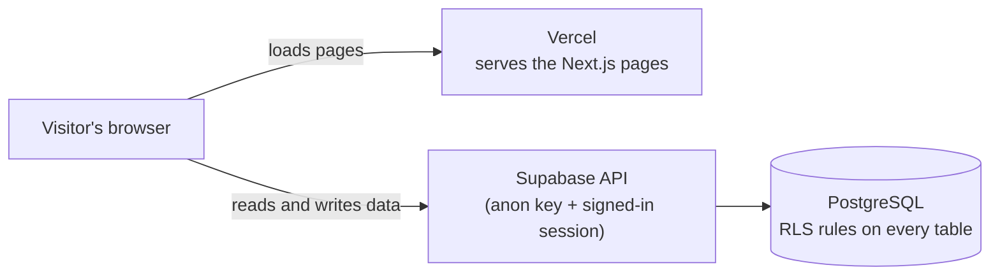
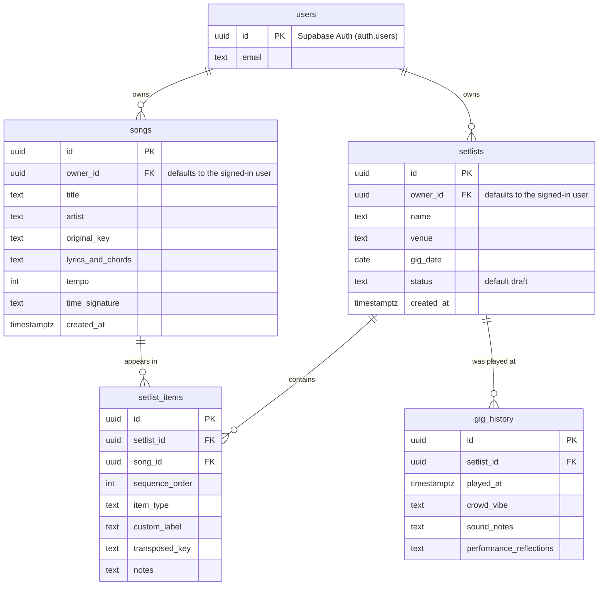

# Architecture

How GigRocker is put together, as of 2026-10-25. Update this file in the same pull request as any change that makes it inaccurate.

## Overview

GigRocker is a Next.js web app hosted on Vercel, with its data in a Supabase (PostgreSQL) database. All pages run in the visitor's browser and talk to Supabase directly, using the project's public "anon" key. There is no server-side code of our own.

Users sign in with email and password through Supabase Auth. The signed-in session is kept in the browser and sent with every database request, so the database knows who is asking.

That has one big consequence: **the database's Row Level Security (RLS) rules are the only thing that decides what anyone can read or change.** The anon key is visible to anyone who opens the site, by design, so the rules have to be right for every table. The sign-in screen only decides what the page shows; the rules decide what data comes back.

**Why the session lives in the browser:** Supabase's Next.js guides also offer server-side sessions in cookies, using `@supabase/ssr`. GigRocker doesn't need them while every page runs in the browser: they would add server code without adding protection, because the rules are the lock either way. Revisit this if server-rendered pages need to know who is signed in.

## Environments

| | Production | Staging |
| --- | --- | --- |
| Purpose | Real use | Testing before release |
| Code deployed from | `main` branch | any other branch or pull request (Vercel preview) |
| Supabase project | GigRocker, `xuovllfdugsfvdqqjvho` | GigRocker-Staging, `mwavgdpfulntroqeuopg` |
| Vercel environment variables | "Production" set | "Preview" set |

Both environments run the same code and the same migrations, but never share data. The code contains no database addresses or keys; Vercel supplies `NEXT_PUBLIC_SUPABASE_URL` and `NEXT_PUBLIC_SUPABASE_ANON_KEY` for each environment.

## Code layout

| Path | What it is |
| --- | --- |
| `app/layout.js` | Page shell shared by every page (dark theme, page title). Wraps every page in `AuthGate` |
| `app/components/AuthGate.js` | Shows the sign-in form until someone is signed in, then the page, with a header showing who is signed in and a Sign out button |
| `app/components/SignInForm.js` | Email and password sign-in. There is no sign-up form |
| `app/page.js` | Home page, linking to the song library |
| `app/songs/page.js` | Song library: add a song, list songs. Also contains a chord-transposing helper that isn't wired up yet |
| `lib/supabase.js` | Creates the Supabase client from the two environment variables. It also keeps the signed-in session |
| `supabase/config.toml` | Supabase CLI settings (used for local tooling, not by the live site) |
| `supabase/migrations/` | The database structure, as numbered SQL files. See [database.md](database.md) |
| `tailwind.config.js`, `postcss.config.js` | Styling build setup |
| `eslint.config.mjs` | Code-checking rules (`npm run lint`) |

## Data model

- Deleting a setlist also deletes its items and its gig history entries (`on delete cascade`).
- Deleting a song keeps any setlist items that used it, with the song link cleared (`on delete set null`).
- Only `songs` is used by the app today. The other three tables were created ahead of the setlist builder, and no part of the app uses them yet.
- Songs and setlists record their owner in `owner_id`, a link to the user in Supabase Auth. It's filled in automatically with whoever is signed in when the row is added. Setlist items and gig history belong to their setlist. A user who still owns songs or setlists can't be deleted (`on delete restrict`).
- `owner_id` is required, and the access rules below are built on it.

## Security model

| Table | Signed-out visitor | Signed-in user |
| --- | --- | --- |
| `songs` | Nothing | Read, add, change and delete their own songs only |
| `setlists` | Nothing | Read, add, change and delete their own setlists only |
| `setlist_items` | Nothing | The same, for items in their own setlists. An item may only use their own songs |
| `gig_history` | Nothing | The same, for history of their own setlists |

- RLS is on for every table. No rule applies to signed-out visitors (the `anon` role), and every rule names the role it applies to. The tests in `supabase/tests/` check all of this on every pull request.
- Adding or changing a record requires `owner_id` to be the signed-in user, so nobody can create records in someone else's name or hand theirs over.
- Accounts are created only by the project owner in the Supabase dashboard. Sign-ups are switched off in both projects.
- The **anon key** is public and safe to expose, because RLS limits what it can do.
- The **service_role key** bypasses RLS entirely. It must never appear in the app, the repo, or Vercel's `NEXT_PUBLIC_` variables.
- Database passwords are used only by the Supabase CLI on a developer's machine, and are never stored in the repo.

## Deployment

- **Code:** pushing a branch makes Vercel build a preview against staging. Merging to `main` makes Vercel build and deploy production. Node 24 is pinned in `package.json`, and `package-lock.json` pins every dependency version, so both environments build identically.
- **Database:** migrations are applied to staging with the Supabase CLI during development. Production is automatic: Supabase's GitHub integration ("Deploy to production") applies new migrations when a pull request merges into `main`, and reports the result as the "Supabase Preview" check on the merge commit. See [database.md](database.md).
- **Checks:** every pull request runs GitHub Actions ([`.github/workflows/ci.yml`](../.github/workflows/ci.yml)). One job lints and builds the site. The other applies every migration to a throwaway database and runs the access tests in `supabase/tests`. No secrets are involved and neither database is touched. `main` is protected: it only accepts pull requests whose checks pass.

## Not built yet

- Phases 2 to 5 of accounts and sharing: the setlist builder, simple sharing, collaborators and the open network. Phase 1, private login, is done. See [requirements/accounts-and-sharing.md](requirements/accounts-and-sharing.md).
- Password reset by email (for now, reset in the Supabase dashboard), and editing or deleting songs in the app.
- A decision on what data staging should hold once other people use the app (a scrubbed copy of production, or made-up sample data)
